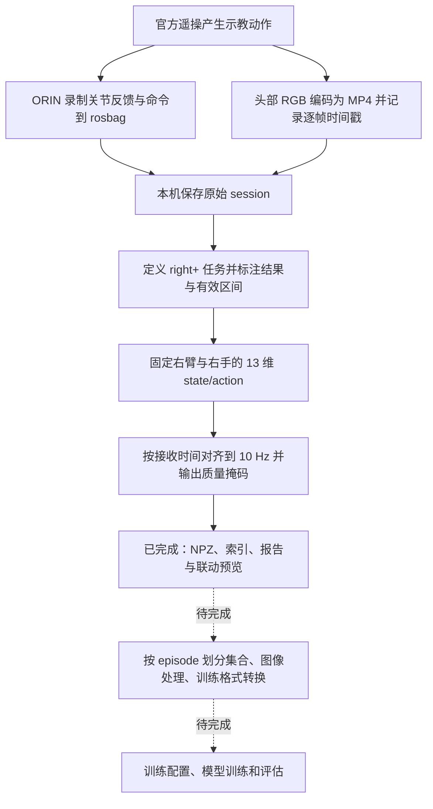

# A2：机器人示教采集与 Diffusion Policy 训练数据准备

本项目保存智元远征 A2 的示教采集脚本、原始录制数据、任务标注，以及面向模仿学习的离线数据处理结果。当前训练数据准备以 `right+` 任务为主：**右臂依次堆叠三个方块，并回到初始默认位置**。

**截至 2026-10-16，已完成数采、`right+` 任务定义与结果标注、有效区间确认、观测/动作表示定义和 10 Hz 多路时间对齐。当前产物是可追溯的对齐中间数据，尚未完成训练集划分、最终训练格式转换或模型训练。**

[README_data.md](README_data.md) 保留数采时的个人命令备忘录；[A2_RUNBOOK.md](A2_RUNBOOK.md) 和 [A2_RUNBOOK_new.md](A2_RUNBOOK_new.md) 保留历史联调记录。本文以当前目录中的实际代码和产物为准，不要求按历史记录重新执行已经完成的操作。

## 1. 当前进度与数据流



| 阶段 | 当前结果 | 依据或产物 |
|---|---|---|
| 数采与回传 | 已完成当前批次录制，保留关节命令、反馈和视觉时间信息 | `data/`、采集 manifest、录制日志 |
| 明确任务输入、起点和完成条件 | 已完成 `right+` 基础定义；部分部署判定细节待补充 | `annotations/right_plus/task_definition.json` |
| 复核示教质量与标注结果 | 106 段均按用户确认标为成功；关键过程可见、无失误和遮挡 | `annotations/right_plus/episodes.csv`、各段 manifest |
| 确认有效动作区间 | 用户确认 106 段整段有效，保留堆叠和归位，无需语义裁剪 | `start_video_s=0`、结束为视频全长 |
| 确定模型观测和动作 | 头部 RGB，加 13 维关节反馈；监督为 13 维绝对目标位置命令 | `processed/right_plus_step34/joint_schema.json` |
| 统一时间轴 | 106 段处理成功，生成 40,097 个 10 Hz 对齐时间点 | `dataset_index.json`、`episodes/*.npz` |
| 验证中间结果 | 已核对因果性、时间网格、形状、质量掩码和源文件指纹 | `verification.json` |
| 最终训练数据集与模型 | 待完成 | 当前没有数据集划分、归一化器、训练入口配置或模型权重 |

这里的“示教成功”来自用户对已有示教的确认；程序完成的是数据结构和时间质量检查，未逐段重新观看全部视频来独立判定任务成功。

## 2. 项目目录与文件作用

```text
A2/
├── README.md                         # 当前项目说明和完整处理流程
├── README_data.md                    # 数采命令备忘录，保留原文
├── A2_RUNBOOK.md                     # 早期联调记录
├── A2_RUNBOOK_new.md                 # 追加视频录制等内容的联调记录
├── AimDK-A2-Ultra-V1.3-0130/          # 随项目保存的官方 SDK
├── AimDK-A2-Ultra-V1.3-0130.zip       # 原始 SDK 压缩包，本地保留、单独归档
├── scripts/                          # 采集、视频编码、离线预览及对齐程序
├── data/                             # 原始录制和早期预览，不随普通 Git 提交
├── annotations/right_plus/           # right+ 的任务定义、标注与修改前备份
├── processed/right_plus_step34/      # 观测/动作定义及时间对齐结果
├── datasets/                         # 大文件归档说明、文件清单与 SHA-256
├── .gitignore                        # 排除原始数据、本地设置、缓存及归档暂存
└── .release-assets/                  # 本机上传暂存与状态，不属于训练数据格式
```

仓库里的同类 episode 文件按命名规则成组保存：下文说明每一种文件的含义，不逐条列出 106 段的重复文件名。新建的空文件 `READEME.md` 仍保留；GitHub 项目入口使用本文件 `README.md`。

### 2.1 `scripts/`：本项目实际使用的程序

| 文件 | 作用 | 输入与输出 |
|---|---|---|
| [`a2_grasp_collect.py`](scripts/a2_grasp_collect.py) | 数采总入口，提供 `preflight`、`record`、`validate`、`label` | 在机器人 ORIN 上发现 ROS 2 话题，启动 rosbag 和可选的视频进程，写 session、manifest、QoS 和日志；`validate` 会更新 manifest 中的技术校验结果，`label` 会写结果标签 |
| [`a2_video_recorder.py`](scripts/a2_video_recorder.py) | 采集脚本调用的视频辅助进程 | 订阅相机 `Image`，通过 FFmpeg/libx264 生成 MP4，逐帧写时间戳 CSV，并输出编码统计和日志 |
| [`a2_bag_preview.py`](scripts/a2_bag_preview.py) | 离线预览 SQLite rosbag，内含 CDR 解析器 | 从含原始图像的 bag 导出 PNG、HTML、关节范围和约 10 Hz 的预览轨迹；仅用 Python 标准库，不发布话题；当前预览入口要求单个 `.db3` |
| [`a2_prepare_right.py`](scripts/a2_prepare_right.py) | `right+` 观测/动作审计与多路时间对齐 | 读取原始 manifest、bag、头部 MP4 和逐帧 CSV，按名称选择右侧关节，生成 NPZ、逐段 JSON、索引、质量报告和预览页；离线运行，不依赖 ROS 或 GPU |
| [`test_a2_prepare_right.py`](scripts/test_a2_prepare_right.py) | 对齐核心逻辑的单元测试 | 检查关节名匹配、手指别名、两种 CDR 对齐形式、纳秒精度、重复拍摄时间戳、接收因果性和陈旧数据掩码 |
| [`download_data.sh`](scripts/download_data.sh) | 从仓库 Release 恢复已归档的数据 | 下载压缩分卷，校验后拼接解压，再逐文件校验；`--verify` 只核验现有 `data/`；已有 `data/` 时不会直接覆盖恢复 |
| `__pycache__/` | Python 自动生成的缓存 | 可重新生成，不是原始数据或训练产物，已被 Git 忽略 |

采集程序负责记录示教，实际动作由已验证的遥操/控制链路产生。`--side right` 用于任务侧标签和相机选择；原始关节话题仍可能含双侧数据，右侧通道在离线阶段按名称提取。

### 2.2 `data/`：原始录制数据

当前目录分组如下。表中数量按现有 `manifest.json` 统计，反映录制 session 数量，不等于已批准用于同一训练任务的样本数。

| 路径 | 当前 session 数量 | 在本项目中的用途 |
|---|---:|---|
| `data/right/right+/` | 106 | 当前已定义、标注并完成 10 Hz 对齐的右臂三层方块堆叠任务 |
| `data/right/right-/` | 92 | 另一组右臂任务；与 `right+` 分开，未纳入本次处理 |
| `data/left/left+/` | 58 | 左臂原始录制分组，未纳入本次 `right+` 处理 |
| `data/left/left-/` | 57 | 另一组左臂原始录制，未纳入本次处理 |
| `data/right_T/right+/`、`data/right_T/right-/` | 4、5 | 独立的右臂录制分组；本项目尚未把 `_T` 明确定义为训练/验证/测试集合 |
| `data/left_T/left+/`、`data/left_T/left-/` | 5、5 | 独立的左臂录制分组，同样不按目录名推定数据集划分 |
| `data/老方案/left/` | 14 | 保留的旧方案左臂录制 |
| `data/20261008_091821_4bcb9b/` | 1 | 早期三相机原始图像 rosbag 样本及离线预览，适合说明旧的图像录包方式 |

`+`、`-` 在这里是原有目录分组名，不自动代表成功/失败。任务结果以 manifest 和标注表为准；当前只对 `right+` 给出了完整的单任务训练语义。

一段 `right+` 录制的结构示例：

```text
data/right/right+/right_001/20261008_110841_e6b694/
├── manifest.json
├── qos.yaml
├── recorder.log
├── video_recorder.log
├── bag/
│   ├── bag_0.db3
│   └── metadata.yaml
└── video/
    ├── head.mp4
    ├── head_timestamps.csv
    ├── config.json
    ├── ready.json
    ├── summary.json
    └── head_ffmpeg.log
```

| 文件或目录 | 保存的内容 | 后续处理中的作用 |
|---|---|---|
| `right_001/` 等目录 | 原采集编号 | 组织一次或多次 session，不直接作为成功标签 |
| `20261008_110841_e6b694/` 等目录 | 时间和随机后缀组成的单次 session | 保持一段完整示教的文件关联，后续按完整 session 划分数据集 |
| `manifest.json` | 任务、物体、操作者、侧别、相机、话题、录制配置、结果和技术校验；已有数据还含标注来源及旧标签 | 判断数据身份、任务一致性、成功标注和来源；早期模板任务名不能替代当前任务定义 |
| `qos.yaml` | rosbag 录制使用的 QoS 覆盖配置 | 复现采集订阅设置，排查话题有发布但未录到等问题 |
| `bag/bag_*.db3` | SQLite rosbag：关节反馈、关节命令及录到的其他话题 | 提取状态和动作监督；视频模式下 RGB 不重复写入 bag |
| `bag/metadata.yaml` | rosbag 文件、话题、消息数和时长等元数据 | 描述录包结构，与 `.db3` 一起保留 |
| `video/head.mp4` | 当前 `right+` 的头部 RGB 视频：1280×720、标称 15 FPS | 训练图像来源；本阶段不复制成逐帧图像 |
| `video/head_timestamps.csv` | `frame_index`、`header_stamp_ns`、`receive_unix_ns` | 将 MP4 帧与机器人接收时间联系起来，是跨模态对齐的关键 |
| `video/config.json` | 相机名、话题和编码帧率配置 | 说明视频进程的录制设置 |
| `video/ready.json` | 视频辅助进程的就绪信息 | 采集主程序据此等待视频进程启动 |
| `video/summary.json` | 收到、写入、丢弃的帧数，首尾时间戳、编码退出码和错误 | 技术质量检查；与逐帧 CSV 和 MP4 元信息共同核对 |
| `recorder.log` | rosbag 进程日志 | 排查录包启动、退出和写入问题 |
| `video_recorder.log`、`video/head_ffmpeg.log` | 视频辅助进程和编码器日志 | 排查相机数据、编码和收尾异常 |

选择其他相机组合时可能出现 `chest_left.mp4`、`chest_right.mp4` 及对应 CSV/日志；早期 `images` 模式把图像保存在 bag 中，未必存在 `video/`。由预览工具额外生成的 `preview/` 包含 `index.html`、抽帧 PNG、`joint_ranges.csv` 和 `joint_trace_10hz.csv`，属于检查用派生结果，不替代原始录制。

### 2.3 `annotations/right_plus/`：任务定义、标注及修改记录

| 文件或目录 | 作用 |
|---|---|
| [`README.md`](annotations/right_plus/README.md) | 解释任务、结果标注依据、有效区间填写方法和未确定事项 |
| [`task_definition.json`](annotations/right_plus/task_definition.json) | 机器可读的任务定义：初始布局、行为顺序、成功条件、观测/动作、边界策略及处理状态 |
| [`episodes.csv`](annotations/right_plus/episodes.csv) | 一行对应一段示教，共 106 行；包含源路径、任务和结果、标注来源、视频帧数/时长、有效起止秒数、训练纳入标记和备注 |
| `manifest_backups/right_*/<session>/manifest.original.json` | 106 份修改前 manifest 原文备份，用于追溯最初采集标签 |
| `revisions/before_full_episode_confirmation_20261016/` | “整段有效”确认之前的一版标注快照 |
| 上述 `revisions/` 下的 `README.md`、`task_definition.json`、`episodes.csv` | 保留当时的说明、任务定义和标注表，当前使用上层的最新版本 |
| 上述 `revisions/` 下的 `manifests/right_*/<session>/manifest.before_full_episode_confirmation.json` | 106 份整段有效确认前的 manifest，用于对照标注的后续变化 |

原采集模板中的 `task=grasp_cup_right`、`object=cup_01` 已在这批 `right+` manifest 中修正为实际任务，并保存在 `acquisition_labels_original` 中。结果标注改变的是元数据，原始 bag、MP4 和逐帧时间戳不因标注而改写。

### 2.4 `processed/right_plus_step34/`：对齐中间结果

目录名中的 `step34` 对应“第三步：观测/动作表示”和“第四步：统一时间轴”。

| 文件或目录 | 作用 |
|---|---|
| [`README.md`](processed/right_plus_step34/README.md) | 本阶段结果的使用说明、表示定义、质量提示及复现方法 |
| [`joint_schema.json`](processed/right_plus_step34/joint_schema.json) | 固定通道顺序、单位、动作语义、图像关联方式、时间对齐规则和新鲜度阈值；后续训练程序应遵守此契约 |
| [`dataset_index.json`](processed/right_plus_step34/dataset_index.json) | 全数据入口索引：106 段的 episode ID、NPZ 路径、视频路径、对齐/有效/无效点数及提示 |
| `episodes/<原编号>__<session>.npz` | 每段的对齐数组：状态、动作、视频帧索引、时间戳和质量掩码，共 106 份 |
| `episodes/<原编号>__<session>.json` | 与 NPZ 一一对应的审计信息：原始关节名和范围、各流频率、时间戳质量、边缘覆盖、源文件指纹和提示，共 106 份 |
| [`episode_quality.csv`](processed/right_plus_step34/episode_quality.csv) | 每段对齐点数、有效点数、源帧最大间隔、接收/拍摄时间差、首尾覆盖和质量提示 |
| [`joint_ranges.csv`](processed/right_plus_step34/joint_ranges.csv) | 13 个通道的全数据反馈/命令最小值与最大值，以及动作是否恒定；这是观测统计，不是硬件安全限位或训练归一化器 |
| [`report.md`](processed/right_plus_step34/report.md) | 处理汇总、时间策略、数值范围和逐段提示 |
| [`verification.json`](processed/right_plus_step34/verification.json) | 既有结果的验证记录：全量结构/因果性/整数时间检查、源文件指纹核对、36 个独立 SQL/CDR 数值块交叉检查，以及预览页冒烟检查 |
| [`preview.html`](processed/right_plus_step34/preview.html) | 本地离线联动预览：选择示教和通道，比较视频、位置反馈与目标命令 |
| `preview_data.js` | 预览页加载的下采样曲线、相对视频路径和质量提示；不是完整训练数组，完整数值应读 NPZ |

示例对应关系：原始 `right_001/20261008_110841_e6b694/` 对应 `episodes/right_001__20261008_110841_e6b694.npz` 和同名 `.json`。NPZ 不内嵌图片，而是保留原 MP4 的准确帧索引。

### 2.5 `datasets/`：大文件归档与校验

这个目录用于数据分发，不是模型训练用的 Dataset 类或最终张量格式。

| 文件 | 作用 |
|---|---|
| [`README.md`](datasets/README.md) | Release 数据恢复和校验说明 |
| `data-inventory.json` | 归档快照的原始数据文件路径、大小、总文件数和总字节数 |
| `data-files.sha256` | 归档时每个原始文件的 SHA-256，用于恢复后核对完整性 |
| `archive-parts.sha256` | 压缩分卷的 SHA-256 和拼接顺序 |
| `sdk-archive.sha256` | 原始 SDK ZIP 的 SHA-256 |

`data/`、原始 SDK ZIP、`.release-assets/` 和下载暂存目录 `.download-assets/` 被普通 Git 忽略。原始数据采用仓库 Release 附件分发；下载前先确认对应 Release 和全部分卷已发布，`git clone` 本身不会恢复 `data/`。本机 `.release-assets/` 中的压缩分卷、上传脚本、日志和状态文件只是归档操作产物。

### 2.6 `AimDK-A2-Ultra-V1.3-0130/`：SDK 与协议依赖

SDK 主目录为 `AimDK-A2-Ultra-V1.3-0130/agibot_a2_aimdk-dev1.3/`，用于理解机器人的话题和字段，并在采集端加载协议依赖。

| SDK 路径或文件 | 作用 |
|---|---|
| `README.md` | SDK 自带的说明入口 |
| `protocol/protobuf/aimdk/protocol/` | 按机器人功能划分的 `.proto` 接口定义，涵盖运动控制、遥操、传感、导航、任务等；配套 `setup.py`、`pyproject.toml`、`MANIFEST.in`、`VERSION` 描述 Python 包构建 |
| `protocol/ros2/ros2_plugin_proto/msg/RosMsgWrapper.msg` | ROS 2 的消息包装接口定义 |
| `protocol/ros2/ros2_plugin_proto/srv/RosRpcWrapper.srv` | ROS 2 的 RPC 服务包装接口定义 |
| 同一 ROS 2 包中的 `package.xml`、`CMakeLists.txt`、`build.sh` | 包依赖、构建配置和构建入口 |
| `prebuilt/a2_aimdk-1.3.0-py3-none-any.whl` | 已打包的 Python SDK |
| `prebuilt/ros2_plugin_proto_aarch64/` | ARM64/ORIN 使用的预构建 ROS 2 协议包 |
| `prebuilt/ros2_plugin_proto_x86_64/` | x86_64 主机使用的对应协议包 |
| 预构建包中的 `include/` | C/C++ 消息、服务及类型支持头文件和生成代码 |
| 预构建包中的 `lib/` | 编译后的 ROS 2 消息与类型支持动态库 |
| 预构建包中的 `local/lib/python3.10/dist-packages/` | Python 绑定及相关 C 扩展支持代码 |
| 预构建包中的 `share/` | ROS 2/ament 元数据及环境加载脚本，例如 `share/ros2_plugin_proto/local_setup.bash` |
| `format.sh`、`.clang-format`、`.pycodestyle` | SDK 的代码格式化入口与风格配置 |
| `.gitignore` | SDK 自带的构建产物忽略规则 |
| `password.md` | SDK 附带的访问/联调记录，不属于训练数据 |

`examples/` 保存 SDK 自带的接口示例：

| 子目录 | 示例涉及的功能 |
|---|---|
| `agent/` | 语音、麦克风、智能体属性、人脸及媒体调用 |
| `hal_audio/` | 音量查询和设置 |
| `hds/` | 告警、异常和诊断信息 |
| `light/` | RGB 灯状态和设置 |
| `mc/` | 运动控制、关节状态、手部/颈部及 Action 调用 |
| `mm/` | 地图和拓扑信息查询 |
| `motion_player/` | 动作播放和播放状态 |
| `other/` | 电池、急停、系统及 OTA 等状态查询 |
| `pnc/` | 导航、相对运动及导航动作管理 |
| `rc/` | 表情和动作列表及播放接口 |
| `resource_manager/` | 资源创建、查询、修改、删除和迁移；`resource/` 保存示例资源 |
| `sensors/` | 相机、鱼眼校正、RGB-D 对齐、IMU、激光雷达及旧版示例 |
| `task_engine/` | 任务查询、启动和状态控制 |

这些示例不是本项目的训练入口。GitHub 中较高的 C/C++ 语言占比来自两种架构的预构建 ROS 2 接口文件；采集和后处理主逻辑位于 `scripts/`，使用 Python。

## 3. 从数采到训练数据准备：已完成的流程

### 3.1 采集：同时保留“看到了什么”和“发出了什么命令”

当前 `right+` 采用 `--side right --cameras head --visual-mode video` 录制。头部原始 RGB 通过视频辅助进程编码为 H.264 MP4，关节反馈和目标命令写入 SQLite rosbag。图像与关节数据都保留时间信息，便于离线重新构造同一时刻的观测和监督。

| 数据流 | 来源 | 当前用途 |
|---|---|---|
| 右臂位置反馈 | `/motion/control/arm_joint_state` | 13 维 `state` 的前 7 维 |
| 右手位置反馈 | `/motion/control/hand_joint_state` | `state` 的后 6 维 |
| 右臂目标位置命令 | `/motion/control/arm_joint_command` | 13 维 `action` 的前 7 维 |
| 右手目标位置命令 | `/motion/control/hand_joint_command` | `action` 的后 6 维 |
| 头部 RGB | `/aima/hal/rgbd_camera/head_front/color` | 视觉观测，由 MP4 与逐帧 CSV 保存 |

该批数据的关节反馈实测约 100 Hz，关节命令约 480～495 Hz，头部视频标称 15 FPS。不能直接按这些数据流各自的行号配对，因此需要后续的统一时间轴。

录制结束后的 `validate` 会检查必需话题是否有消息、命令是否存在、进程是否正常退出，以及视频文件、逐帧编号、写入数量、丢帧比例和编码结果。技术校验通过表示录制具备基本完整性，任务是否成功另由任务标注决定。

### 3.2 第一步：明确 `right+` 的输入、起点与完成条件

任务 ID 为 **`right_plus_stack_cubes`**，任务对象标为 **`large_medium_small_cubes`**。

**初始条件：**

- 右臂处于示教时的初始默认姿态。
- 三个方块按“左大、中小、右中”摆放，即从左到右为大方块、小方块、中方块。
- 头部视角能够看到关键操作过程。

**完整动作顺序：**

1. 从默认姿态出发，抓取初始位于右侧的中方块。
2. 将中方块放到左侧的大方块上并松手。
3. 抓取初始位于中间的小方块。
4. 将小方块放到中方块上并松手。
5. 右臂回到初始默认位置。

**完成条件：**由下到上形成“大、中、小”三层堆叠；右手已经松开，方块不依靠手部支撑且不掉落；右臂已经归位。归位属于任务动作，训练片段需要保留。

模型输入已明确为“头部 RGB＋右臂 7 关节反馈＋右手 6 通道反馈”。单任务基线的动作监督来自实录命令，因此本阶段未制作方块框、逐帧动作名称或物体轨迹标签。

仍未固定的任务细节包括：“左、中、右”具体按哪个观察视角判断、默认姿态的数值及归位容差、方块具体尺寸，以及部署时头部/躯干的精确设置。任务定义中建议未来评测在松手后观察 2 秒稳定性，但这不是已经对全部示教额外核验过的固定完成条件。

### 3.3 第二步：复核质量、标注结果并确认有效动作区间

当前 106 段均已按用户确认记录：示教成功、无失误和遮挡、头部视角覆盖关键动作、整段有效。当前最新标注为：

| 字段 | 当前值及含义 |
|---|---|
| `task_id` | `right_plus_stack_cubes` |
| `outcome` | `success` |
| `outcome_source` | `user_confirmation`，明确成功结论的来源 |
| `start_video_s` | `0`，从视频开头使用 |
| `end_video_s` | 每段 MP4 的完整播放时长 |
| `boundary_review_status` | `user_confirmed_full_episode` |
| `include_in_training` | `yes`，表示该 episode 被纳入候选训练数据 |

**本批完成的是有效区间确认，结论为无需按动作阶段裁剪。** 原始视频保留完整的堆叠和右臂归位过程。后续时间对齐只去掉缺少多路共同记录的技术性边缘，含义见第 3.5 节。

对于以后新增且需要裁剪的示教，边界应覆盖“物体摆好、右臂在初始姿态、即将开始第一次运动”到“小方块放好并松手、右臂归位、保留必要末尾观察”。录制前准备、长时间空等、任务结束后的人工重新摆放及下一次任务不应混进有效区间。边界秒数使用 MP4 播放时间，后续应通过帧号和 CSV 映射到接收时间。

**当前转换器的边界：** `a2_prepare_right.py` 检查 manifest 的任务 ID、侧别和成功结果，但不读取 `episodes.csv` 来执行起止秒数裁剪或 `include_in_training` 过滤。当前 106 段全部成功、整段使用，因此这两种口径一致；未来若排除某段或标注部分区间，需要先扩展/落实相应选择与裁剪逻辑，再重新处理，不能只改 CSV 就假定 NPZ 已同步变化。

### 3.4 第三步：确定模型观测与动作表示

在每个决策时刻，视觉观测关联一帧头部 RGB；低维状态 `state` 保存机器人实测位置，监督 `action` 保存遥操链路下发的绝对目标位置。二者使用相同的 13 维顺序：

| 下标 | 通道 | 单位 |
|---|---|---|
| 0～6 | `right_arm_joint1` ～ `right_arm_joint7` | rad |
| 7 | `right_thumb_0` | SDK 手指抽象位置 |
| 8 | `right_thumb_1` | SDK 手指抽象位置 |
| 9 | `right_index` | SDK 手指抽象位置 |
| 10 | `right_middle` | SDK 手指抽象位置 |
| 11 | `right_ring` | SDK 手指抽象位置 |
| 12 | `right_pinky` | SDK 手指抽象位置 |

处理时依据 `JointState.name` 匹配右侧通道，并处理 `idx..._` 前缀和 SDK 手指别名，避免依赖原数组中左右侧的排列。六个手部通道分别保留；关节 6/7 使用记录中的并联腕等效串联坐标。

- `state`、`action` 均为 `float32`，形状 `[T, 13]`；这里 `T` 是该 episode 的对齐时间点数。
- `action` 的含义为命令话题中的绝对位置设定值，未转为关节增量；反馈与命令分别保留。
- 手指位置标称 0～2000，实录反馈最高为 2015；当前保留原值，没有把手指当成弧度或盲目截断。
- `hand_command_effort` 作为 `[T, 6]` 辅助数组保存，不增加位置动作的输出维度。该批记录恒为 `[13000, 8000, 8000, 8000, 8000, 8000]`，与 SDK 文档中标称范围存在差异，控制适配前需要核对实际固件和单位。
- 图像当前保留原始 1280×720 MP4 和帧索引；未做训练用缩放、裁剪或批量 RGB 解码。后续使用 OpenCV 解码时需要处理 BGR→RGB。
- 尚未拟合归一化器；应先按完整 episode 划分集合，再只使用训练集拟合，并处理恒定通道。

### 3.5 第四步：统一时间轴，对齐视频、关节状态和动作

#### 使用哪个时间

以同一 ORIN 的 Unix 接收时钟作为共同基准：

- 关节四路流使用 rosbag 中的接收时间 `timestamp`。
- 视频使用逐帧 CSV 中的 `receive_unix_ns`。
- 相机拍摄时间 `header_stamp_ns` 和关节消息的 header 时间另行保留，用于分析时钟偏差与延迟，不直接替代接收时间。

MP4 是按固定帧率播放的视频文件。`frame_index / fps` 得到播放器秒数，但播放秒数与 ROS 接收时钟不一定相同；当前处理没有统一减去一个假定的相机延迟。

#### 如何建立每一行

1. 求头部相机、手臂反馈、手部反馈、手臂命令和手部命令五路数据的共同覆盖区间。
2. 从共同起点开始，以整数纳秒建立 10 Hz 网格，相邻时间点间隔 `100,000,000 ns`。
3. 对每个决策时刻 `t`，分别选取各流中**接收时间不晚于 `t` 的最新一条数据**，即零阶保持。
4. 将反馈拼成 13 维 `state`、命令拼成 13 维 `action`，并记录头部视频 `head_frame_index`。
5. 保存各源数据距 `t` 的接收年龄，并生成 `valid_sample` 掩码。

选择规则保证不会用到当时尚未收到的图像或关节数据。这里的“对齐”是复现同一决策时刻已经可用的信息，不意味着各设备恰好同时拍摄、测量或执行。

实际第一段中，某一行 `time_s=10.0` 关联原 MP4 第 148 帧，对应播放位置约 `9.867 s`。它同时具有一行 13 维状态和一行 13 维命令，说明不能直接把“第 10 秒播放画面”等同于“第 10 秒决策时间”。

#### 如何处理边缘与陈旧数据

- 在共同覆盖区间建立网格，不为开始时缺失的某路关节数据填造测量值；结束时不足一个网格周期的尾部不额外补样本。原始 MP4 和 bag 仍完整保留。
- 本批视频开头早于全部关节流可用的最长差值约 `1.047121 s`，视频末尾超过共同采样网格的最长差值约 `0.172935 s`。这类技术边缘处理不等于按任务动作重新裁剪。
- 关节接收年龄超过 `50 ms`，或相机接收年龄超过 `200 ms` 时，该行标为 `valid_sample=False`。
- 无效行仍留在原时间位置。后续训练的时序窗口必须避开/拒绝跨越这些行；不能先删行，再把两边动作拼成时间连续的序列。

全批 106 段均处理成功：

| 项目 | 结果 |
|---|---:|
| 原始头部视频帧 | 60,117 |
| 10 Hz 对齐时间点 | 40,097 |
| 新鲜度合格时间点 | 40,076 |
| 带新鲜度掩码的时间点 | 21 |
| 含新鲜度掩码的 episode | 11 |
| 相机源帧间隔超过 200 ms 的 episode | 4 |
| 出现重复拍摄时间戳的 episode | 1 |
| 手指反馈略超标称范围的 episode | 84 |
| 视频启动时缺少共同关节覆盖超过 0.25 s 的 episode | 29 |

这些检查类别可以重叠。任务成功标注和技术质量掩码分别表达不同信息；带提示的 episode 未因此自动整段丢弃。

## 4. 对齐 NPZ 的字段与读取方式

| 字段 | 形状 / 类型 | 含义 |
|---|---|---|
| `timestamp_ns` | `[T]` / `int64` | 统一的绝对决策时间，整数纳秒 |
| `time_s` | `[T]` / `float64` | 从当前 episode 共同起点开始的相对秒数 |
| `state` | `[T, 13]` / `float32` | 右臂与右手实测位置反馈 |
| `action` | `[T, 13]` / `float32` | 相同顺序的绝对目标位置命令 |
| `head_frame_index` | `[T]` / `int64` | 原始 `head.mp4` 中从 0 开始的帧号 |
| `head_playback_s` | `[T]` / `float64` | 关联帧的播放器秒数 |
| `valid_sample` | `[T]` / `bool` | 该时间点的所有输入与命令是否满足接收新鲜度要求 |
| `arm_state_receive_ns`、`hand_state_receive_ns`、`arm_command_receive_ns`、`hand_command_receive_ns` | 各 `[T]` / `int64` | 被选中的四路关节消息接收时间 |
| 对应的 `*_header_ns` | 各 `[T]` / `int64` | 同一条消息的原始 header 时间 |
| 对应的 `*_age_ms` | 各 `[T]` / `float64` | 该消息接收时间距决策时刻的毫秒数 |
| `head_receive_ns`、`head_header_ns` | 各 `[T]` / `int64` | 被选图像的接收时间和原始拍摄时间 |
| `head_receive_age_ms`、`head_capture_age_ms` | 各 `[T]` / `float64` | 图像接收时间/源时间距决策时刻的差，用于质量或延迟诊断 |
| `hand_command_effort` | `[T, 6]` / `float32` | 本批实际保留的右手命令 effort 辅助值 |

脚本在命令流存在完整 effort 数组时还可保存对应的 `arm_command_effort`；当前这批实际 NPZ 中未包含该字段。读取时以真实键集合和 `joint_schema.json` 为准。

在项目根目录、可导入 NumPy 的 Python 环境下读取一段：

```python
from pathlib import Path
import numpy as np

path = Path("processed/right_plus_step34/episodes/") / (
    "right_001__20261008_110841_e6b694.npz"
)
with np.load(path, allow_pickle=False) as episode:
    print(episode["state"].shape)       # 第一段为 (524, 13)
    print(episode["action"].shape)      # 第一段为 (524, 13)
    print(episode["valid_sample"].sum())
    print(episode["head_frame_index"][:5])
```

这里读取的是全部规则时间点，包括保留原时间位置的无效点；后续构造模型时间窗口时还需应用掩码规则。图片应按该行帧号从对应的原始 MP4 解码。

## 5. 如何查看与复现

### 5.1 查看已完成的对齐结果

恢复原始 `data/` 并保持目录关系后，用本地浏览器打开：

```bash
cd /home/fx/A2
xdg-open processed/right_plus_step34/preview.html
```

选择 episode 和关节通道，拖动视频或点击曲线即可比较画面、位置反馈和目标命令。预览通过相对路径引用源 MP4；只有 Git 仓库而没有恢复数据时，曲线仍有静态数据，但视频源文件不在本地。曲线用于检查示教数据，不是模型预测。

### 5.2 重新生成观测/动作与时间对齐结果

当前结果已经生成，无需为了阅读本项目重复处理。以后重做时，在本机现有 `robocasa_dp` 环境中运行：

```bash
cd /home/fx/A2
/home/fx/miniconda3/envs/robocasa_dp/bin/python scripts/a2_prepare_right.py \
  --root data/right/right+ \
  --out processed/right_plus_step34_rerun \
  --hz 10 \
  --max-joint-age-ms 50 \
  --max-camera-age-ms 200
```

离线处理依赖 NumPy、OpenCV；`sqlite3`、CSV 和二进制解析使用 Python 标准库。现有验证记录使用 NumPy 2.2.5、OpenCV 5.0.0，这些是当时的环境记录，并非声明其他版本不能使用。环境名 `robocasa_dp` 也不表示本仓库已经包含完整训练工程。

程序要求输入任务 ID 一致、侧别为 right、结果为 success；输出目录必须为空且在原始输入树之外。`--limit` 仅用于小规模处理检查，正式全量处理时省略。原始输入只读，重新处理时使用新输出目录，以保留既有结果供比较。

已有核心逻辑测试可在同一环境运行：

```bash
/home/fx/miniconda3/envs/robocasa_dp/bin/python -m unittest discover \
  -s scripts -p 'test_a2_prepare_right.py'
```

### 5.3 后续继续采集同类任务

采集端为机器人 ORIN，需要已经正确加载的 ROS 2 Humble、DDS 和对应架构的 `ros2_plugin_proto` 环境，以及支持 `libx264` 的 FFmpeg。将 `a2_grasp_collect.py` 与 `a2_video_recorder.py` 放在同一目录。具体机器登录和环境加载命令仍保留在数采备忘录中。

下面为以后新增 `right+` 示教的调用模板；将占位目录和操作者改为实际值，不重复使用既有 episode 编号：

```bash
python3 a2_grasp_collect.py preflight \
  --side right --cameras head --visual-mode video

python3 a2_grasp_collect.py record \
  --side right --cameras head --visual-mode video \
  --task right_plus_stack_cubes --object large_medium_small_cubes \
  --operator <operator_id> --duration 180 --out <new_episode_parent>

python3 a2_grasp_collect.py validate <generated_session>
python3 a2_grasp_collect.py label <generated_session> --outcome success
```

`label` 只应在实际复核结果后填写；它不会替代任务定义和标注表的维护。`--allow-state-only` 是录制链路调试选项，没有动作命令的数据不能直接提供本项目所需的动作监督。

对于早期原始图像录包，可以在本机运行：

```bash
python3 scripts/a2_bag_preview.py data/20261008_091821_4bcb9b \
  --every 5 --stride 2
```

对当前视频模式的示教，应查看 `video/head.mp4` 或本阶段的联动预览；bag 中没有重复保存的头部原始图像，无法由旧预览工具从该 bag 抽出这些视频帧。

## 6. 已完成的验证与当前边界

[`verification.json`](processed/right_plus_step34/verification.json) 记录当前中间数据检查通过，覆盖 106 段、40,097 行及 21 个带掩码行：

- 状态与动作矩阵形状、通道数和有限数值检查。
- 整数纳秒网格及规则步长检查。
- 全量检查各流被选接收时间不晚于决策时间。
- 新鲜度掩码与各流年龄阈值的一致性检查。
- 处理前后源文件指纹一致性检查。
- 抽取三段示教、三个时刻，以直接 SQL 和已有独立 CDR 解析路径交叉核对 36 个关节数据块。
- 预览页的 106 段选择、13 通道选择、视频源和初始曲线标签检查。

上述检查包含 MP4 元信息帧数和 CSV 的一致性，但尚未全量逐帧解码全部视频，也没有将用户确认的成功结论重新当作自动视觉评估。源文件指纹中，小型 JSON/CSV 保存了 SHA-256，大型 bag/MP4 在本阶段记录大小和修改时间；分发归档另有 `datasets/` 中的逐文件 SHA-256 清单，两者用途不同。

## 7. 从当前产物继续搭建训练

当前可以提供“同一决策时间上的图像帧索引、13 维反馈状态、13 维命令监督和质量掩码”。要进入单任务 Diffusion Policy 训练，还需要完成以下工作，当前目录中尚无这些实现或产物：

1. **按完整 episode 划分训练、验证、测试集。** 固定划分清单与随机种子；避免把同一示教相邻帧随机分到不同集合。现有 `_T` 目录也尚未被认定为最终测试集。
2. **落实时序窗口的有效性规则。** 在每段内部构造观测历史和动作序列，避开 `valid_sample=False`，不跨 episode 或技术性无效间隔连接序列。
3. **完成图像预处理。** 依据 `head_frame_index` 解码选中帧、转 RGB，确定统一尺寸和裁剪方式，并检查解码结果；这些设置需要在训练和部署中保持一致。
4. **构建最终 Dataset 和存储格式。** 将图像、state、action、episode 边界及窗口规则接到所选训练代码。当前 NPZ＋MP4 索引是中间格式，尚未生成可直接交给所选官方训练入口的 Zarr 或相应 Dataset 适配器。
5. **只用训练集拟合归一化参数。** 分别处理手臂 rad 和手指抽象量纲，保存统计与恒定维处理方式，并在验证、测试与部署中复用。
6. **确定训练配置并运行基线。** 包括视觉编码器、观测历史长度、动作预测长度、10 Hz 时序设置、优化与检查点规则等；当前尚无训练曲线、模型检查点或模型性能结论。
7. **设计离线评估与实机适配。** 最终评测需要覆盖完整堆叠和归位条件；执行侧仍需核对通道、单位、默认姿态、手部 effort 语义及实际控制映射。

当前的 `include_in_training=yes` 表示 episode 进入候选集合，`valid_sample=True` 表示该时间点满足技术新鲜度要求；二者都不等同于已经完成训练集划分或模型训练。

## 8. 进一步阅读

- [原数采备忘录](README_data.md)：现场使用的命令记录。
- [当前 right+ 标注说明](annotations/right_plus/README.md)：任务、结果和区间的详细约定。
- [当前对齐结果使用说明](processed/right_plus_step34/README.md)：中间数据的使用方法。
- [当前处理报告](processed/right_plus_step34/report.md)：范围与逐段技术提示。
- [数据归档说明](datasets/README.md)：Release 分卷的恢复与校验。
- [SDK 自带说明](AimDK-A2-Ultra-V1.3-0130/agibot_a2_aimdk-dev1.3/README.md)：协议与预构建包入口。
